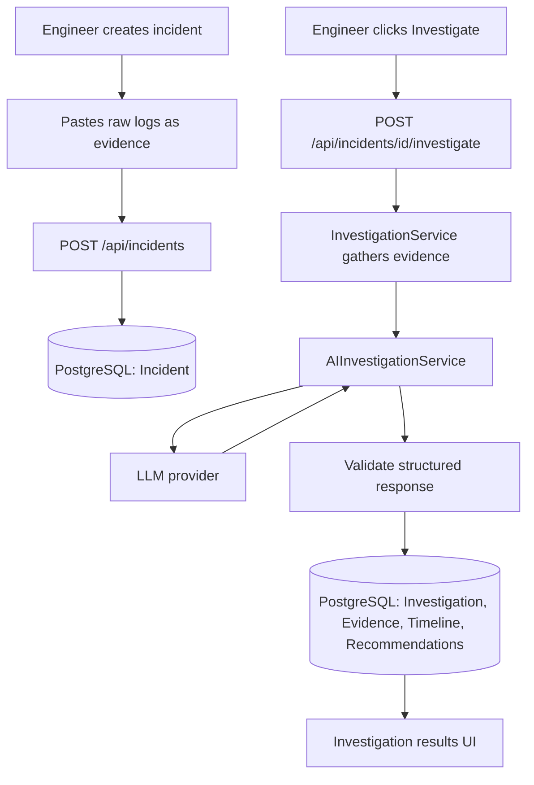
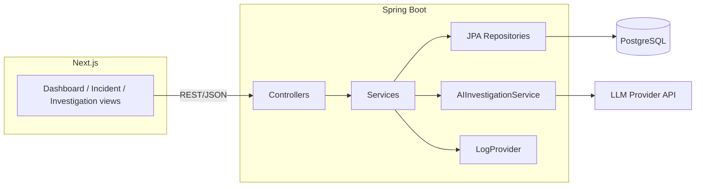

# IncidentIQ Architecture

## Product flow

## System components

## Extensibility seams

- **`AIInvestigationService`** — swap the LLM provider without touching controllers, services, or the DB schema.
- **`LogProvider`** — MVP ships a pasted-log implementation only; `OpenSearchLogProvider` / `DatadogLogProvider` / `SplunkLogProvider` can be added later behind the same interface.
- **DTOs everywhere at the API boundary** — entities are never returned directly, so the schema can evolve without breaking the frontend contract.

## Explicitly deferred (see spec §23)

OpenSearch, Datadog, Splunk, Prometheus/Grafana, GitHub/GitLab, Jira, Slack, ServiceNow, AWS, Kubernetes, historical-incident RAG/vector search, automated remediation, runbooks, notifications, SSO, RBAC, multi-tenancy, billing.
